## ez_go

可以看出是 AES + Base58：

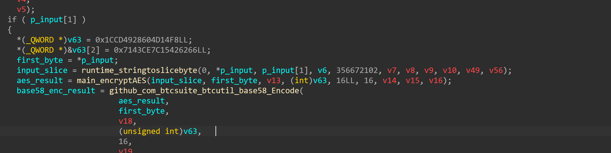

动调提 key：

```
0xf8, 0x14, 0x4d, 0x60, 0x28, 0x49, 0xcd, 0x1c, 0x66, 0x62, 0x42, 0x15, 0x7c, 0xce, 0x43, 0x71
```

`compare` 函数在 `goroutine` 里，`newproc` 起 `goroutine`，入口为 `gowrap1`：

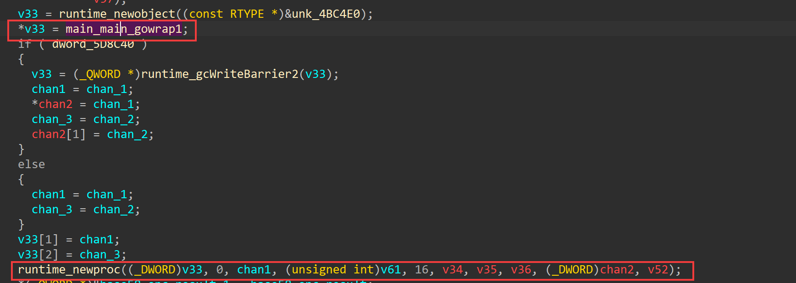

和 `compareBase58WithCiphertext` 一个东西：

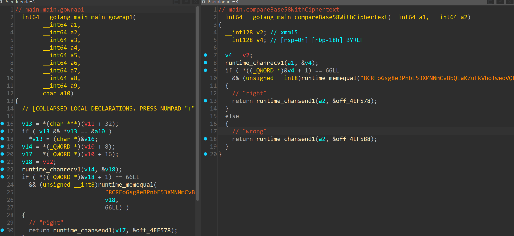

拿到密文：`8CRFoGsg8eBPnbE53XMNNmCvBbQEaKZuFkVhoTweoVQLozxhHaXKm2oSvcsGxxPCuR`，试试 `aes-ecb`，出了：

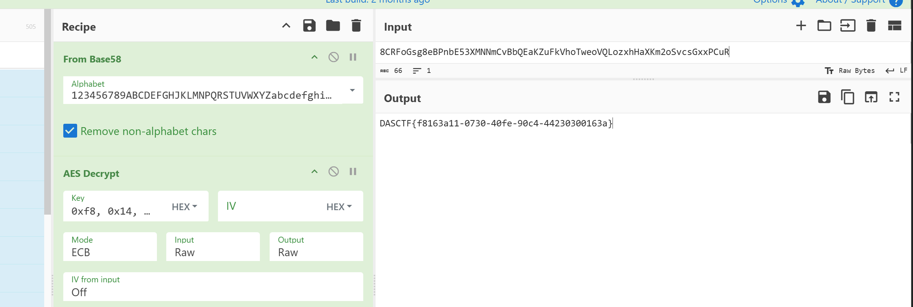

## LastDeparture

### 改标志脱壳

ELF UPX，改标志就能脱：

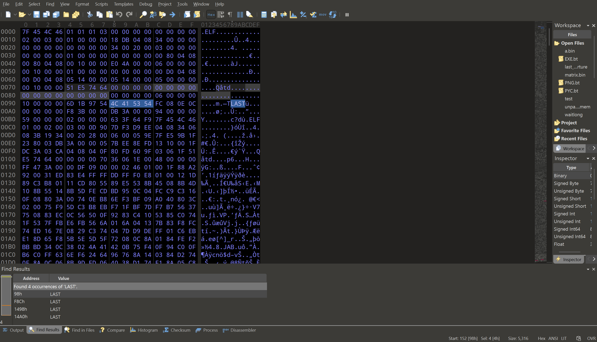

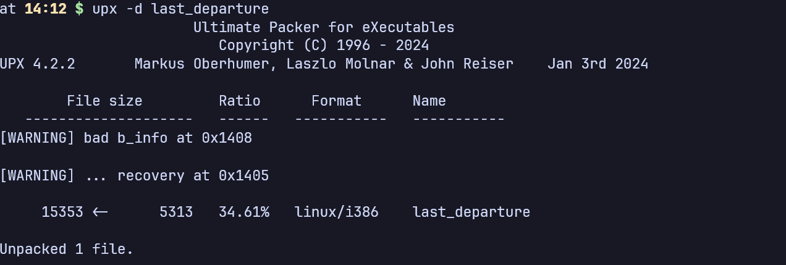

### 手动脱壳

也可以试试用 `pwndbg` 手动 `dump` 一下：

```pwndbg
file last_departure
catch syscall munmap # 断在 munmap 进入和推出处
r # munmap enter
c # munmap ret
c # munmap enter
c # munmap ret
```

upx 分为壳 + 压缩后的程序；壳里有 <span data-tooltip="加载器" tabindex="0">loader</span>，壳能加载 loader；loader 能解压程序；由于 loader 是临时的，其完成解压后会被 `munmap`，所以

- 第 1 个 `munmap` 释放壳
- 第 2 个 `munmap` 释放 loader，此时已经解压完成

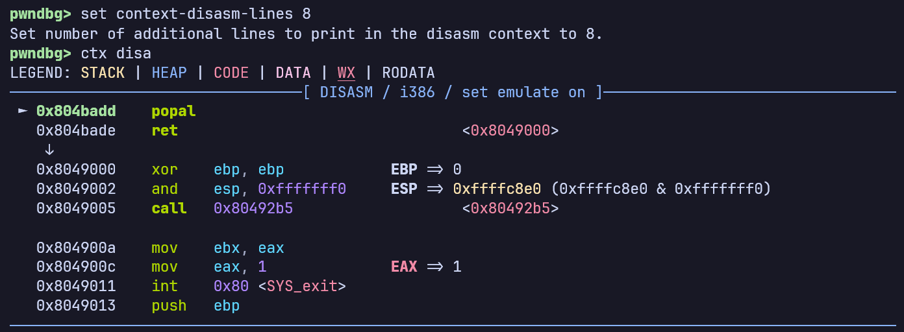

`0x8049000` 初始化栈后调 `0x80492b5`，后面还有 `SYS_exit`，`0x80492b5` 是 `main`，dump 整页下来：

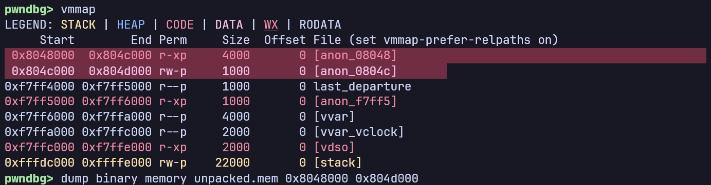

### 脚本 Patch

IDA 打开，可以看到加密函数是被加密的：

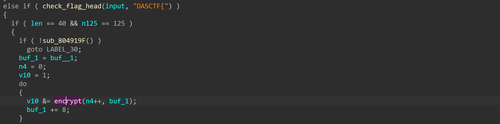

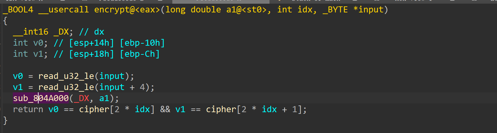

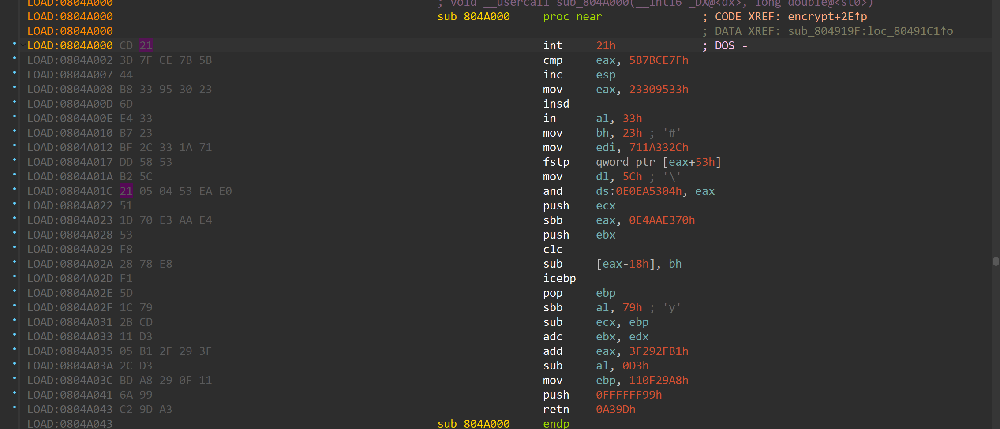

交叉引用下找解密逻辑，写脚本 patch 一下：

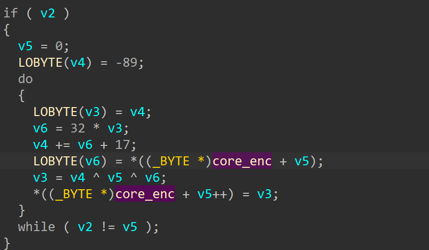

```python
import ida_bytes
from pathlib import Path

image = Path('/path/to/LastDeparture/unpacked.mem').read_bytes()
page = bytearray(image[0x2000:0x3000])
key = 0xa7
for i in range(0x1000):
    key = ((key + (key << 5) & 0xff) + 0x11) & 0xff
    page[i] ^= (i & 0xff) ^ key

ida_bytes.patch_bytes(0x804A000, bytes(page))
```

### 手动 Dump

或者动调 dump 一下： 

```pwndbg
catch syscall munmap
r
c
c
c
b *0x08049282 # loader 解压完了再下软件断点（0xcc）
c
```

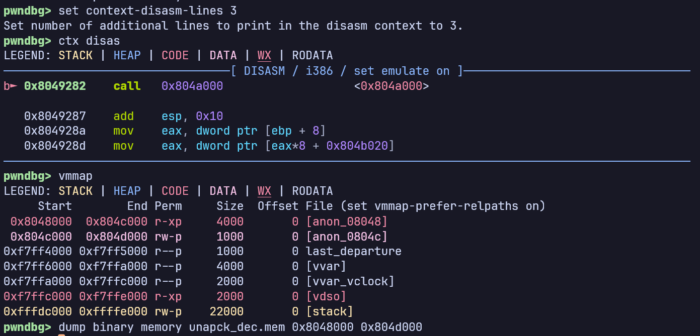

是个魔改 TEA：

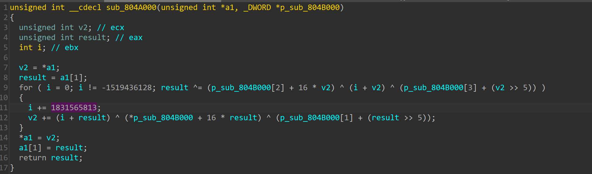

解密：

```python
#include <stdio.h>
#include <stdlib.h>
#include <stdint.h>
#include <string.h>

#define ARRLEN(arr) (int)(sizeof(arr) / sizeof(arr[0]))

void TEA_decrypt(uint32_t v[2], const uint32_t key[4])
{

    uint32_t v0 = v[0], v1 = v[1], delta = 0x6D2B79F5;
    uint32_t s = 0;
    for (int i = 0; s != 0xA56F3EA0; i++){
        s += delta;
    }
    printf("%x     \n", s);

    for (int i = 0; s != 0; i++)
    {
        v1 ^= ((v0 << 4) + key[2]) ^ (v0 + s) ^ ((v0 >> 5) + key[3]);
        v0 -= ((v1 << 4) + key[0]) ^ (v1 + s) ^ ((v1 >> 5) + key[1]);
        s -= delta;
    }
    v[0] = v0;
    v[1] = v1;
}

void print(uint8_t *data, int len)
{
    int i;
    for (i = 0; i < len; ++i)
    {
        printf("%02X ", data[i]);
        if ((i + 1) % 16 == 0 || i == len - 1)
        {
            int j;
            printf(" ");
            for (j = (i / 16) * 16; j <= i; ++j)
            {
                printf("%c", (data[j] >= 32 && data[j] <= 126) ? data[j] : '.');
            }
            printf("\n");
        }
    }
    printf("%s", data);
}

int main(){
    uint32_t key[4] = {0xc0dec0de, 0x31415926, 0xf1e2d3c, 0xdecafbad};

    uint32_t cipher[8] ={0x45eae15a, 0x6c842d01, 0xa445c19, 0x7b0cd1bf, 0xb3861dc3, 0x54b6cd5a, 0xbe3a7ca5, 0xa7833b1c};

    for(int i = 0;i < 8;i += 2){
        TEA_decrypt(&cipher[i], key);
    }
    print(cipher, 8 * 4);
	return 0;
}
// r41l_7Qmn1ght_K9t1ck3t_6h0m3_R2x
```

