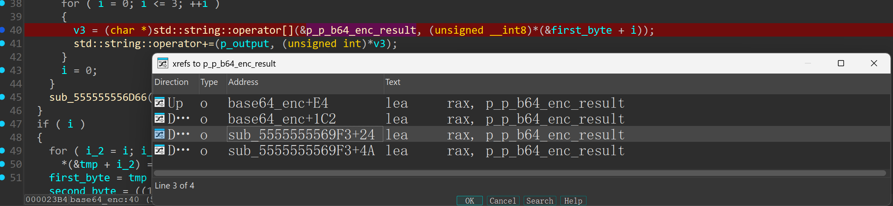
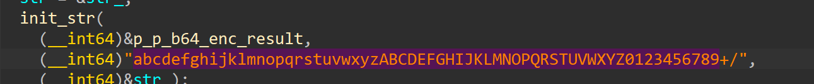
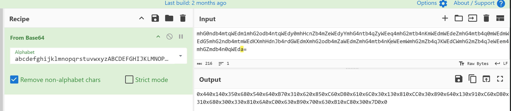
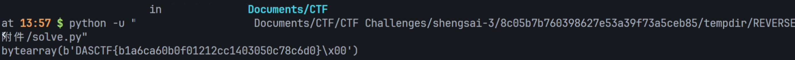
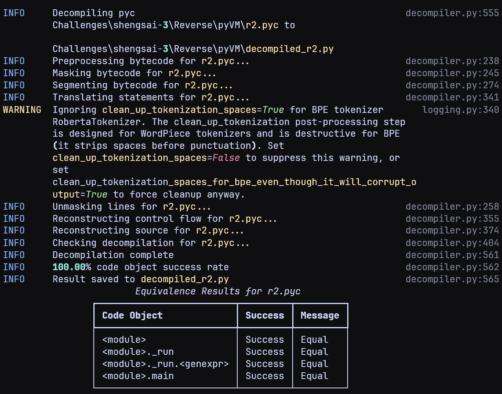
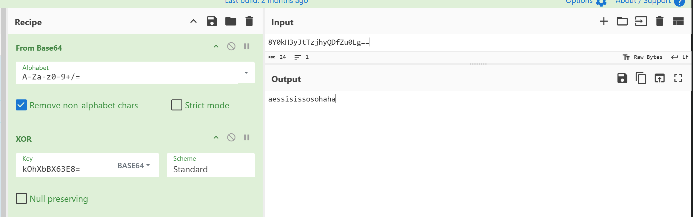

## shift

> 加密：输出差分的左移 + 换表 base64，没魔改，没有调试检测
>
> 解密：换表 base64 + 输入差分的右移

能看到 `rol8` 和 `base64_enc`，flag长度和差分初始值均为 `0x28`，注意 base64 是换表的，`rol8` 是输出差分的，看看能不能厨子梭：





`base64_table = abcdefghijklmnopqrstuvwxyzABCDEFGHIJKLMNOPQRSTUVWXYZ0123456789+/`



再写个小脚本：

```python
def ror(x: int, k: int, width: int) -> int:
    k %= width
    mask = (1 << width) - 1
    x &= mask
    return ((x >> k) | ((x << (width - k)) & mask)) & mask

cipher = [0x44,0x14,0x35,0x68,0x54,0x64,0xb7,0x31,0x62,0x85,0xc6,0xd8,0x61,0x6c,0x03,0x13,0x81,0xcc,0x03,0x89,0x64,0x13,0x91,0xc6,0xd8,0x31,0x68,0x30,0x33,0x81,0x6a,0xc0,0x63,0xb9,0x70,0x63,0xb1,0xc8,0x30,0x7d,0x00]

shift = 0x28
flag = []
for val in cipher:
    dec = ror(int(val), shift, 8)
    flag.append(dec)
    shift = val

print(bytes(flag))
```



## PyVM

本地 pylingual 进行反编译：



```python
# C:\path\to\pylingual.exe .\r2.pyc
# Decompiled with PyLingual (https://pylingual.io)
# Bytecode version: 3.12.0rc2 (3531)

import sys
_PROG = b'0\x10576>46.32\xcc1\xb0566\xdc46!32\xcc1\xda556\\46X32\xcc1\xf8546\x8446\xf432\xcc1\xbb536B46I32\xcc1\x92526f46\xcf32\xcc1\xa6516f46M32\xcc1\x1a506h46\xc032\xcc1i5?6\x9846&32\xcc1[5>6\x8246\x9532\xcc1\x8e5=6\xfe46\xb232\xcc1\xfa5<6\x1c46\xad32\xcc1\xe85;6\xc646\x9232\xcc1$5:6X46u32\xcc1\xba596N46)32\xcc1\x18586\xd046\x9732\xcc1\x8b5\'6\x1046632\xcc1\xa95&6\x1446\xc532\xcc1\x025%6\xf046\x9532\xcc1\'5$6\xb446\xa732\xcc1\x845#6T46332\xcc1\'5"6\xe846\xc032\xcc1W5!6\x9c46"32\xcc1B5 6\xce46h32\xcc1I5/6\x9e46\xfc32\xcc1\xfb5.6x46\xcf32\xcc1\xe85-6\xaa46\xe332\xcc1\x135,6J46\xf132\xcc1;5+6\x9246\x8d32\xcc1\xcd5*6X46\xaf32\xcc1\x1f5)6\x1a46\xd132\xcc1\x905(6\x1446\xb032\xcc1\r5\x176\x8246:32\xcc1\x1e5\x166046o32\xcc1\x1d5\x156P46~32\xcc1r5\x146\x1246y32\xcc1*5\x136046\x8232\xcc1\x135\x126\x9c46`32\xcc1\x8e5\x116b46G32\xcc1\xf47'
_XK = 55
def _run(s):
    prog = bytes((b ^ _XK for b in _PROG))
    pc = 0
    st = []
    while pc < len(prog):
        op = prog[pc]
        pc += 1
        if op == 0:
            return True
        if op == 1:
            st.append(prog[pc])
            pc += 1
        else:
            if op == 2:
                st.append(ord(s[prog[pc]]))
                pc += 1
            else:
                if op == 3:
                    b = st.pop()
                    a = st.pop()
                    st.append(a * b)
                else:
                    if op == 4:
                        b = st.pop()
                        a = st.pop()
                        st.append(a + b)
                    else:
                        if op == 5:
                            m = prog[pc]
                            pc += 1
                            st.append(st.pop() % m)
                        else:
                            if op == 6:
                                t = prog[pc]
                                pc += 1
                                if st.pop() != t:
                                    return False
                            else:
                                if op == 7:
                                    if len(s) != prog[pc]:
                                        return False
                                    else:
                                        pc += 1
                                else:
                                    return False
    return True
def main():
    try:
        s = sys.stdin.readline().rstrip('\n')
    except Exception:
        print('[-] read error')
        return None
    if _run(s):
        print('[+] Correct! The flag is what you entered.')
    else:
        print('[-] Wrong.')
main()
```

加个 `print` 打印一下机器码：

```python
[7, 39, 2, 0, 1, 9, 3, 1, 25, 4, 5, 251, 6, 135, 2, 1, 1, 235, 3, 1, 22, 4, 5, 251, 6, 237, 2, 2, 1, 107, 3, 1, 111, 4, 5, 251, 6, 207, 2, 3, 1, 179, 3, 1, 195, 4, 5, 251, 6, 140, 2, 4, 1, 117, 3, 1, 126, 4, 5, 251, 6, 165, 2, 5, 1, 81, 3, 1, 248, 4, 5, 251, 6, 145, 2, 6, 1, 81, 3, 1, 122, 4, 5, 251, 6, 45, 2, 7, 1, 95, 3, 1, 247, 4, 5, 251, 6, 94, 2, 8, 1, 175, 3, 1, 17, 4, 5, 251, 6, 108, 2, 9, 1, 181, 3, 1, 162, 4, 5, 251, 6, 185, 2, 10, 1, 201, 3, 1, 133, 4, 5, 251, 6, 205, 2, 11, 1, 43, 3, 1, 154, 4, 5, 251, 6, 223, 2, 12, 1, 241, 3, 1, 165, 4, 5, 251, 6, 19, 2, 13, 1, 111, 3, 1, 66, 4, 5, 251, 6, 141, 2, 14, 1, 121, 3, 1, 30, 4, 5, 251, 6, 47, 2, 15, 1, 231, 3, 1, 160, 4, 5, 251, 6, 188, 2, 16, 1, 39, 3, 1, 1, 4, 5, 251, 6, 158, 2, 17, 1, 35, 3, 1, 242, 4, 5, 251, 6, 53, 2, 18, 1, 199, 3, 1, 162, 4, 5, 251, 6, 16, 2, 19, 1, 131, 3, 1, 144, 4, 5, 251, 6, 179, 2, 20, 1, 99, 3, 1, 4, 4, 5, 251, 6, 16, 2, 21, 1, 223, 3, 1, 247, 4, 5, 251, 6, 96, 2, 22, 1, 171, 3, 1, 21, 4, 5, 251, 6, 117, 2, 23, 1, 249, 3, 1, 95, 4, 5, 251, 6, 126, 2, 24, 1, 169, 3, 1, 203, 4, 5, 251, 6, 204, 2, 25, 1, 79, 3, 1, 248, 4, 5, 251, 6, 223, 2, 26, 1, 157, 3, 1, 212, 4, 5, 251, 6, 36, 2, 27, 1, 125, 3, 1, 198, 4, 5, 251, 6, 12, 2, 28, 1, 165, 3, 1, 186, 4, 5, 251, 6, 250, 2, 29, 1, 111, 3, 1, 152, 4, 5, 251, 6, 40, 2, 30, 1, 45, 3, 1, 230, 4, 5, 251, 6, 167, 2, 31, 1, 35, 3, 1, 135, 4, 5, 251, 6, 58, 2, 32, 1, 181, 3, 1, 13, 4, 5, 251, 6, 41, 2, 33, 1, 7, 3, 1, 88, 4, 5, 251, 6, 42, 2, 34, 1, 103, 3, 1, 73, 4, 5, 251, 6, 69, 2, 35, 1, 37, 3, 1, 78, 4, 5, 251, 6, 29, 2, 36, 1, 7, 3, 1, 181, 4, 5, 251, 6, 36, 2, 37, 1, 171, 3, 1, 87, 4, 5, 251, 6, 185, 2, 38, 1, 85, 3, 1, 112, 4, 5, 251, 6, 195, 0]
```

是个栈机：

| Opcode | Mnemonic |        Oprand        | Instruction Length |
| :----: | :------: | :------------------: | :----------------: |
|   0    |   HLT    |          -           |       1 Byte       |
|   1    |   PUSH   |      `prog[pc]`      |      2 Bytes       |
|   2    | PUSHCHAR |  `input[prog[pc]]`   |      2 Bytes       |
|   3    |   MUL    |          -           |       1 Byte       |
|   4    |   ADD    |          -           |       1 Byte       |
|   5    |   MOD    |      `prog[pc]`      |      2 Bytes       |
|   6    |   CMP    |      `prog[pc]`      |      2 Bytes       |
|   7    |   LEN    | `len(s)`, `prog[pc]` |      2 Bytes       |

人肉反汇编前几个机器码，可以发现一共 39 个周期，每周期 12 bytes：

```assembly
7, 39  = CMP 39 len(s)
---
2, 0   = PUSH prog[0]
1, 9   = PUSH 9 (a) (+3)
3      = 9 * prog[0]
1, 25  = PUSH 25 (b) (+6)
4 	   = 9 * prog[0] + 25
5, 251 = (9 * prog[0] + 25) % 251 (c) (+9)
6, 135 = (9 * prog[0] + 25) % 251 == 135 (y) (+11)
---
[ ... ]
```

$$
y = (x * a + b) \bmod c \\
x = (y - b) * a^{-1} \bmod c
$$

写脚本解密：

```python
_PROG = b'0\x10576>46.32\xcc1\xb0566\xdc46!32\xcc1\xda556\\46X32\xcc1\xf8546\x8446\xf432\xcc1\xbb536B46I32\xcc1\x92526f46\xcf32\xcc1\xa6516f46M32\xcc1\x1a506h46\xc032\xcc1i5?6\x9846&32\xcc1[5>6\x8246\x9532\xcc1\x8e5=6\xfe46\xb232\xcc1\xfa5<6\x1c46\xad32\xcc1\xe85;6\xc646\x9232\xcc1$5:6X46u32\xcc1\xba596N46)32\xcc1\x18586\xd046\x9732\xcc1\x8b5\'6\x1046632\xcc1\xa95&6\x1446\xc532\xcc1\x025%6\xf046\x9532\xcc1\'5$6\xb446\xa732\xcc1\x845#6T46332\xcc1\'5"6\xe846\xc032\xcc1W5!6\x9c46"32\xcc1B5 6\xce46h32\xcc1I5/6\x9e46\xfc32\xcc1\xfb5.6x46\xcf32\xcc1\xe85-6\xaa46\xe332\xcc1\x135,6J46\xf132\xcc1;5+6\x9246\x8d32\xcc1\xcd5*6X46\xaf32\xcc1\x1f5)6\x1a46\xd132\xcc1\x905(6\x1446\xb032\xcc1\r5\x176\x8246:32\xcc1\x1e5\x166046o32\xcc1\x1d5\x156P46~32\xcc1r5\x146\x1246y32\xcc1*5\x136046\x8232\xcc1\x135\x126\x9c46`32\xcc1\x8e5\x116b46G32\xcc1\xf47'

p = []

for val in _PROG:
    p.append(int(val ^ 55))

pc = 2
flag = []
while p[pc] != 0:
    a = p[pc + 3]
    b = p[pc + 6]
    c = p[pc + 9]
    y = p[pc + 11]
    flag.append(((y - b) * pow(a, -1, c)) % c)
    pc += 12

print(bytes(flag))
```

## easyaosp

JEB 拖进去看一下，是 aes + xor：

```java
public class MainActivity extends AppCompatActivity {
    [ ... ]
    private static final byte XOR_KEY = 86;

    static {
        MainActivity.GIVEN_CIPHER = new byte[]{(byte)0x89, -7, -41, 12, -97, 58, 16, 54, 18, 0x7C, 12, -34, -89, 10, -1, 0x72, 103, -28, (byte)0xE1, 35, -98, -83, (byte)0x81, 0x76, 29, 85, 62, 76, -21, 0x76, 51, 71, -30, 0x7A, 72, -60, 12, 94, 106, 29, 9, -106, -14, (byte)0xC1, -12, 0x7F, (byte)0x8A, -78};
    }

    protected void onCreate(Bundle bundle0) {
	        [ ... ]
            public void onClick(View view0) {
			   [ ... ]
                byte[] arr_b = MainActivity.this.editText.getText().toString().getBytes();
                encrpyto encrpyto0 = new encrpyto();
                try {
                    if(
                        Arrays.equals(
                            encrpyto0.xorWithKey(
                                encrpyto0.aesEncrypt(
                                    arr_b,
                                    encrpyto0.getAESKEy(StringFog.decrypt("8Y0kH3yJtTzjhyQDfZu0Lg==\n", "kOhXbBX63E8=\n"))
                                ),
                                86
                            ),
                            new byte[]{(byte)0x89, -7, -41, 12, -97, 58, 16, 54, 18, 0x7C, 12, -34, -89, 10, -1, 0x72, 103, -28, (byte)0xE1, 35, -98, -83, (byte)0x81, 0x76, 29, 85, 62, 76, -21, 0x76, 51, 71, -30, 0x7A, 72, -60, 12, 94, 106, 29, 9, -106, -14, (byte)0xC1, -12, 0x7F, (byte)0x8A, -78}
                    	)
                      ){ // if end
                        String s1 = StringFog.decrypt("Uz2iPsE8cuY=\n", "IEjBXaRPAcc=\n");
                        Toast.makeText(MainActivity.this, s1, 1).show();
                        return;
                    }

                    String s2 = StringFog.decrypt("ZJeZNVcG\n", "E+X2WzAnfko=\n");
                    Toast.makeText(MainActivity.this, s2, 1).show();
                }
            }
        });
    }
}

```

`aes-128-key`：



梭一下：


## 1byte

附件脚本里加一个 `bsgs` 函数求解 dlp，得到私钥 x，随后解密：

```python
# sage solve.sage
from sage.all import *
from sage.groups.generic import bsgs
import json

with open("params.json") as f:
    d = json.load(f)

p = int(d["p"], 16)
g = int(d["g"], 16)
h = int(d["public_key_h"], 16)
c1 = int(d["ciphertext"]["c1"], 16)
c2 = int(d["ciphertext"]["c2"], 16)

x = bsgs(
    Mod(g, p),
    Mod(h, p),
    (Integer(0), Integer(2**8))
)

if x is not None:
    m = c2 * pow(pow(c1, x, p), -1, p) % p
    print(m.to_bytes((m.bit_length() + 7) // 8, "big").decode())

# DASCTF{b4210c04-15d2-4ed8-be4d-742595e0cdca}
```

